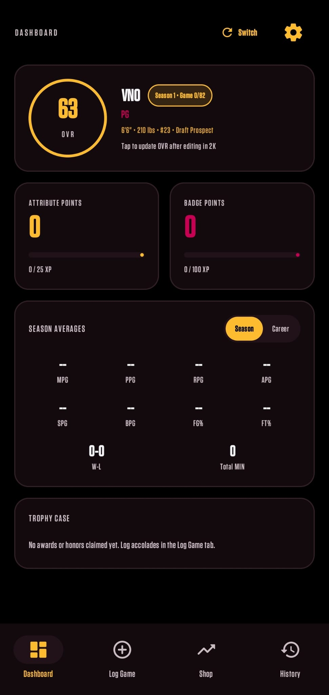
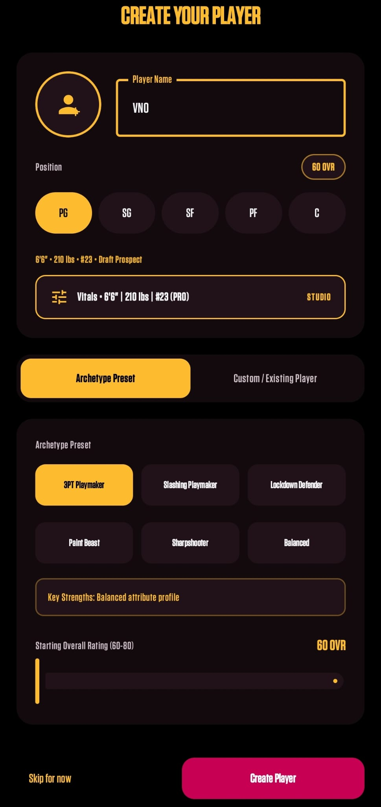
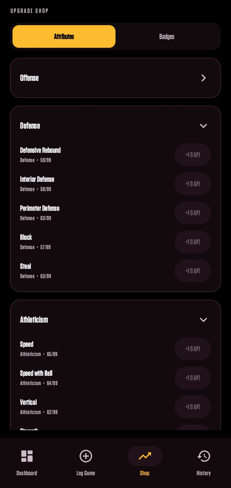
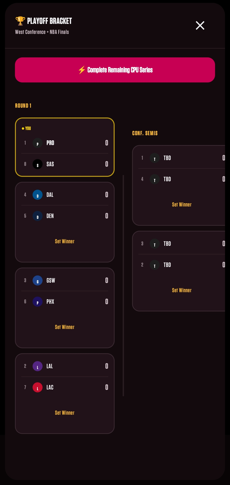

# PlayerLock

An offline Android app built with Kotlin and Jetpack Compose for tracking custom player-lock basketball careers, box scores, and season progression.
## Screenshots

## Screenshots

| Dashboard | Player Creator | Upgrade Shop | Playoff Bracket |
| :---: | :---: | :---: | :---: |
|  |  |  |  |

## Features
- Create custom players with height/weight scaling, jersey previews, 36 attributes, and 53 badges (plus an offline badge glossary).
- Log games manually (`MIN`, `PTS`, `REB`, `AST`, `STL`, `BLK`, `TOV`, `FG`, `FT`) or scan your box score row with the camera.
- Earn Attribute Points (AP) and Badge Points (BP) from your games, milestones, and awards to upgrade your player in the shop.
- Automatic season recap after 82 games, saved season archives, and a Best-of-7 playoff bracket.
- Custom theme picker with Dark, Light, Pure Black AMOLED, 30 team color palettes, and custom accent colors.
- Automatic per-player `.json` backups plus manual export and import.

## Download
Grab the latest `.apk` (`arm64-v8a` for most modern Android phones, or `universal`) from the [Releases](../../releases) page.

## Disclaimer
This is an unofficial, fan-made companion tool for personal stat tracking. It is not affiliated with, endorsed by, or connected to Take-Two Interactive, 2K Games, or the National Basketball Association (NBA).
